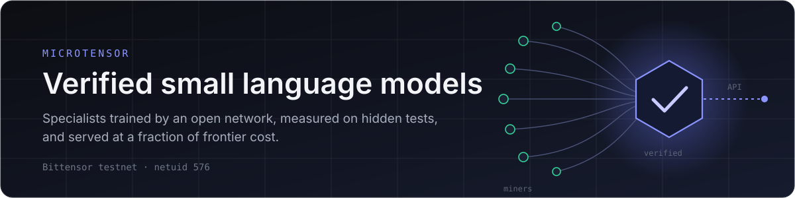
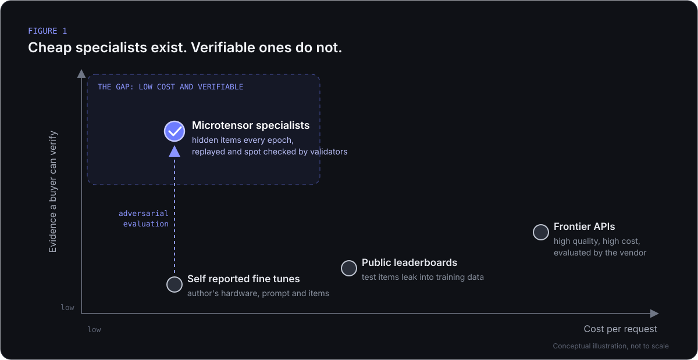
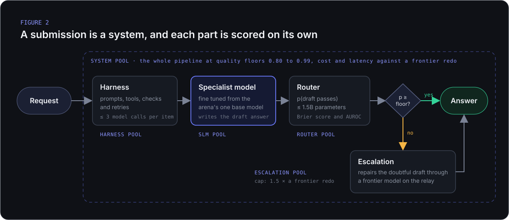
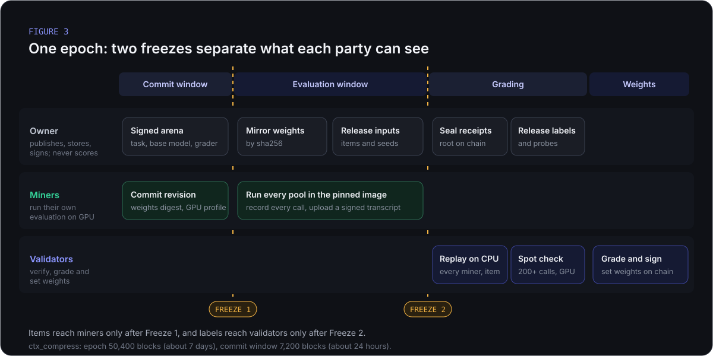
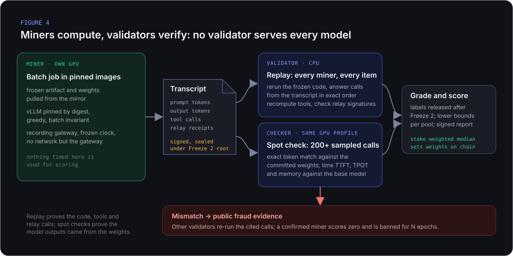
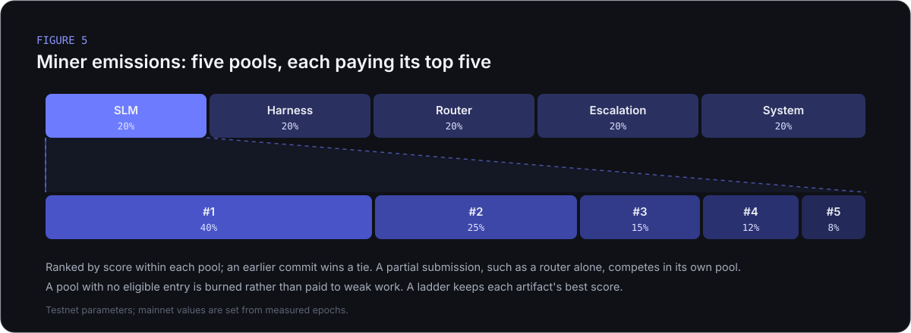

<p align="center">
  
</p>

<p align="center">
  <a href="https://bittensor.com"></a>
  <a href="https://microtensor.cloud/network"></a>
  <a href="https://python.org"></a>
  <a href="https://www.microtensor.cloud/terms"></a>
</p>

<p align="center">
  <a href="https://microtensor.cloud">Website</a> ·
  <a href="https://www.microtensor.cloud/docs/certified-inference">Documentation</a> ·
  <a href="https://www.microtensor.cloud/network/arenas">Arenas</a> ·
  <a href="https://www.microtensor.cloud/docs/certified-inference/system/decentralised-evaluation">Mechanism</a> ·
  <a href="#9-participating">Participate</a>
</p>

---

> **Abstract.** Most production language model traffic is narrow and repetitive, yet it is served by frontier models at frontier cost. Task specific small models can match frontier quality on a fixed distribution at a small fraction of the cost, but the evidence needed to trust them does not exist: public benchmarks leak into training data, and private evaluations are run by the party being evaluated. Microtensor is a Bittensor subnet that treats **evaluation as the primary artifact**. For each task, an *arena* fixes one base model, a grader and a pool of hidden items that is replaced every epoch. Miners fine tune the base and submit a complete system of model, harness, router and escalation path. They run that system on their own GPUs inside pinned images and publish a signed transcript of every call. Validators replay each transcript on CPU, re-execute sampled model calls on identical hardware with an exact token match, and score every part against the base model using one sided lower confidence bounds. The output is a specialist whose published quality is a verified measurement rather than a claim, served through one API.

## Contents

1. [The problem](#1-the-problem)
2. [Approach: evaluation as the primary artifact](#2-approach-evaluation-as-the-primary-artifact)
3. [System model](#3-system-model)
4. [Epoch protocol](#4-epoch-protocol)
5. [Verification](#5-verification)
6. [Scoring](#6-scoring)
7. [Incentives](#7-incentives)
8. [Threat model](#8-threat-model)
9. [Participating](#9-participating)
10. [Arenas](#10-arenas)
11. [Repository layout](#11-repository-layout)
12. [Citation and license](#12-citation-and-license)

---

## 1. The problem

### 1.1 Frontier models are overprovisioned for narrow work

A large share of language model calls in production are the same task repeated: compacting an agent's context, reading a document page, extracting fields, classifying a request. Routing these calls to a general frontier model pays for capability the task never uses. The literature on task specific adaptation is consistent on what a small model can do instead:

| Finding | Source |
|---|---|
| The best small model in an adapted harness recovered **89% of frontier performance at 4% of the cost** across seven business tasks; gains shrank as tasks became more varied | Yang et al., 2026, [arXiv:2607.08938](https://arxiv.org/abs/2607.08938) |
| Fine tuned 4 bit models outperformed GPT-4 by **10 points on average across 31 tasks** | Zhao et al., 2024, [arXiv:2405.00732](https://arxiv.org/abs/2405.00732) |
| A **770M** model trained with distilled rationales outperformed the **540B** PaLM while using 80% of the training data | Hsieh et al., 2023, [arXiv:2305.02301](https://arxiv.org/abs/2305.02301) |

The capability exists. What is missing is a way to know which small model actually has it.

### 1.2 The measurement gap

A buyer choosing a specialist today relies on numbers that fail in three ways:

- **Contamination.** Public test sets are scraped into training corpora over time, so a high score cannot separate a model that generalises from one that memorised the test.
- **Self reporting.** Private evaluations run on the author's hardware, with the author's prompt, on items the author chose.
- **No binding to weights.** Nothing ties a published number to the exact weights and code that produced it, so the model that was measured may not be the model that is shipped.

<p align="center">
  
</p>

**Research question.** *Can an open, adversarial market produce small models whose measured quality is trustworthy enough to replace frontier calls on a defined task, at a cost a validator can afford to verify?*

## 2. Approach: evaluation as the primary artifact

Microtensor inverts the usual order. The model is the by product; the measurement is the product. Five design principles follow from that.

| | Principle | Mechanism |
|---|---|---|
| **P1** | Tests the miner has never seen | Fresh hidden items every epoch, drawn from a seed that does not exist until the epoch opens. Twin items catch memorisation; canary items catch training on previously released inputs. |
| **P2** | One controlled starting point | One base model per arena. Every miner fine tunes the same model, so a score measures training skill rather than the choice of a larger base. |
| **P3** | The measured system is the shipped system | Commitments bind the artifact revision and the weights digest on chain before items exist. Evaluation runs only from a content addressed mirror of those exact files. |
| **P4** | Luck cannot outrank consistency | Scores are one sided lower confidence bounds, paired against the base model on the same items. |
| **P5** | No single trusted party | The owner publishes and stores data but never scores. Validators sign independent reports, and the published figure is the stake weighted median of reports that agree on the inputs. |

How this compares with existing practice:

| | Public benchmarks | Vendor evaluations | Microtensor |
|---|---|---|---|
| Test exposure | public, contaminated over time | private, unverifiable | hidden, replaced every epoch, canaries detect leakage |
| Who runs the model | the author | the vendor | the miner, then replayed and spot checked by others |
| Starting point | any | any | one base model per arena |
| Reported figure | point estimate | point estimate | one sided lower bound |
| Reproducibility | rare | none | deterministic replay of a signed transcript |
| Incentive to be right | none | commercial | emissions against stake weighted consensus |

## 3. System model

An **arena** is one task. Its signed definition fixes the task and grader, the base model and its licence, the tools available, the resource envelope a system must run within, the item counts per pool and the epoch timing. An arena is frozen while live; a stronger base model means a new arena version.

A **submission** is a system of up to four parts, and each part is scored in its own pool. A missing part is replaced by the arena's reference, so a miner can compete on a single part.

<p align="center">
  
</p>

| Part | Role | Scored on |
|---|---|---|
| **Specialist model** | Fine tuned from the arena base; writes the draft answer | Pass rate on hidden items, paired against the base, with efficiency and anti memorisation terms |
| **Harness** | Prompts, tools, checks and retries around the model, at most three model calls per item | Gain over the arena's reference harnesses on the same model and items |
| **Router** | Predicts the probability that a draft passes | Calibration (Brier score) and separation (AUROC) across draft sources and quality floors |
| **Escalation** | Repairs a doubtful draft through a frontier model on the relay | Quality after repair against the cost of a full frontier redo, capped at 1.5× that cost |
| **System** | The whole pipeline | Cost and latency against a frontier redo at quality floors of 0.80, 0.90, 0.95 and 0.99 |

## 4. Epoch protocol

An epoch is a measurement under fixed conditions, separated into phases by two freezes. Each freeze removes the ability of one party to act on information it has not yet seen.

<p align="center">
  
</p>

1. **Commit.** The miner commits its artifact revision, weights digest and declared hardware profile on chain, with a submission fee set per arena.
2. **Freeze 1.** Commitments close. The owner mirrors every committed artifact and weight file by sha256; a miner whose files are missing or do not match is excluded.
3. **Evaluation window.** Task inputs and per item seeds are released, without labels. Each miner pulls its own frozen files from the mirror and runs every pool in the official images, which record every model, tool and relay call into a signed transcript.
4. **Freeze 2.** Uploads close. Transcript receipts are sealed under a Merkle root posted on chain, so no transcript can change afterwards.
5. **Grading.** Labels and probe questions are released. Validators replay, spot check and grade every miner, then sign one report each.
6. **Weights.** Validators set weights with commit reveal; the published figure is the stake weighted median of the reports that agree on bundle, seed, roster and snapshot.

## 5. Verification

The miner performs the expensive computation; validators verify it cheaply. No validator needs to serve every miner's model.

<p align="center">
  
</p>

**Replay (CPU, every miner, every item).** The validator runs the miner's frozen harness code in a sandbox with no network, answers each model call from the transcript and requires every request to match the recording exactly and in order. It recomputes every tool response from the bundle, checks every relay receipt signature and measures the harness's added wall time on its own clock. Any mismatch fails the miner for the epoch.

**Spot check (GPU, sampled).** A checker on the miner's declared hardware profile loads the committed weights and re-runs at least 200 sampled model calls, requiring an exact token match. The sample is drawn from the block hash and the checker's hotkey after Freeze 2, weighted toward passed items, twin items and items that moved the score. A miner that falsified 5% of its calls escapes a 200 call check with probability $0.95^{200} \approx 3.5 \times 10^{-5}$. The same checker times first token latency, time per output token and peak memory against the base model on the same card, so nothing timed on the miner's machine is used.

**Determinism.** Exact matching is possible because a profile is one GPU architecture, one driver line and one image digest, decoding is greedy, and the inference engine runs in batch invariant mode. Different architectures disagree under bf16, so a profile never mixes them, and a new card joins a profile only after a pair test.

| Profile | Hardware | Precision | Batching |
|---|---|---|---|
| P1 | RTX 4090 (sm89); L4 and L40S after the pair test | bf16 | batch invariant |
| P2 | A100 80 GB (sm80) | bf16 | batch invariant |
| P3 | H100 (sm90); H200 after the pair test | bf16 | batch invariant |
| K | 2 × T4 (sm75), small models only | fp16 | single sequence |
| C | x86 CPU, GGUF | GGUF | single sequence |

**Disputes.** A mismatch is published as replayable fraud evidence. Other validators re-run the cited calls themselves before acting; a confirmed miner scores zero and its hotkey is banned for a number of epochs set by the arena.

## 6. Scoring

All scoring runs on graded transcripts with the same code on every validator.

**Item score.** Each arena defines its own grader. For `ctx_compress`, a summary is scored as

$$
s_i = \mathrm{valid}_i \cdot C_i \cdot (1 - h_i) \cdot \tfrac{1}{2}\left(\mathrm{recall}_i + \mathrm{cont}_i\right)
$$

where $\mathrm{valid}_i$ is the schema gate, $C_i$ the compression gate (output at most 10% of the input), $h_i$ the share of invented code identifiers, $\mathrm{recall}_i$ the share of key facts kept, and $\mathrm{cont}_i$ the score of a fixed probe agent that answers questions about the session from the summary alone. An item passes when $s_i \ge 0.5$.

**Lower bound.** With $k$ passes on $n$ items, the pool uses the Wilson lower bound

$$
L = \frac{\hat p + \frac{z^2}{2n} - z\sqrt{\frac{\hat p(1-\hat p)}{n} + \frac{z^2}{4n^2}}}{1 + \frac{z^2}{n}}, \qquad \hat p = \frac{k}{n}
$$

**Specialist model pool.**

$$
S_{\mathrm{SLM}} = L \cdot \tau \cdot \left(1 + r\,E + b\right)
$$

where $\tau$ penalises a gap between original and twin items (memorisation), $E \in [0, 1]$ is the efficiency gain over the base model measured by the spot checker (first token latency 0.4, memory 0.3, parameters 0.2, time per token 0.1), $r$ is the arena's efficiency range (0.25 by default) and $b$ is an edge bonus for also passing a smaller device class. An entry is eligible only if it passes the format, provenance and envelope gates, covers the minimum item count, and its paired lower bound over the base model is above zero.

**System pool.** At each quality floor $f$, a system earns credit only when its lower bound reaches the floor:

$$
v_f = \begin{cases} \min\!\left(1, \dfrac{\max\left(0,\; 0.7 \ln \frac{c_{\mathrm{ref}}}{c} + 0.3 \ln \frac{t_{\mathrm{ref}}}{t}\right)}{\ln 10}\right) & L_f \ge f \\[4pt] 0 & \text{otherwise} \end{cases}
\qquad S_{\mathrm{system}} = \frac{1}{|F|}\sum_{f \in F} v_f
$$

with $c$ and $t$ the cost and p95 latency of the system, and $c_{\mathrm{ref}}, t_{\mathrm{ref}}$ those of a frontier redo on the same items.

## 7. Incentives

<p align="center">
  
</p>

Miner emissions are split equally across the five pools. Within a pool, the top five eligible entries receive 40, 25, 15, 12 and 8 percent. A pool with no eligible entry is burned, so emissions never reward work that fails the bar. **Inference miners** are a separate role: they serve certified systems to customers through the gateway, post collateral, are admitted after probes on withheld items, and are paid on metered usage. See [docs/inference_miner.md](docs/inference_miner.md).

## 8. Threat model

Every known attack maps to a check that any validator can run on its own.

| Attack | Defence |
|---|---|
| Change weights after seeing items | Items release after Freeze 1; spot checks load the frozen digest |
| Edit, force push or delete the Hugging Face repo | Only the committed digest counts; the mirror holds the frozen copy |
| Route model calls to a frontier API or a different local model | Exact token match fails on the spot check |
| Falsify only a few items | Sampled after Freeze 2 from the chain seed, weighted toward items that matter |
| Fake tool or frontier responses | Tools are recomputed from the bundle; only the relay can sign receipts |
| Run different harness code than committed | Replay runs the committed code; requests stop matching |
| Tailor answers to the grader | Labels and probe questions release only after Freeze 2 |
| Memorise or train on released inputs | Twin items reduce the score; canary items from earlier epochs are tested in the next |
| Report false speed or memory | Timed by the checker on validator hardware |
| Copy another miner | Duplicate weight digests and spectral provenance against the base |
| Edit a transcript after the deadline | Receipts sealed under the on chain Merkle root |
| Validator accuses a miner falsely | Evidence is replayable; others verify before acting |

## 9. Participating

| Role | Hardware | What you do | Guide |
|---|---|---|---|
| **System miner** | A GPU of an accepted profile (P1 today) | Fine tune the arena base, build the harness, router and escalation, commit, run your evaluation each epoch | [docs/miner.md](docs/miner.md) · [miner template](https://github.com/microtensor-io/microtensor-miner-template) |
| **Validator** | One CPU box (8 cores, 32 GB RAM, 200 GB NVMe) | Replay, grade and set weights; spot checking is a separate GPU duty | [docs/validator_setup.md](docs/validator_setup.md) |
| **Inference miner** | GPUs that hold a certified system | Serve customer requests through the gateway; paid on metered usage | [docs/inference_miner.md](docs/inference_miner.md) |

```bash
git clone https://github.com/microtensor-io/microtensor-subnet.git
cd microtensor-subnet
pip install -e .

# check a model the way the mirror and runner will
mt check-model --slm ./slm_repo --profile P1 --arena ctx_compress
```

Register on testnet with `btcli subnet register --netuid 576 --subtensor.network test`. The full documentation, including the training playbook, lives at [microtensor.cloud/docs](https://www.microtensor.cloud/docs/certified-inference).

## 10. Arenas

Arena definitions live in [microtensor-arenas](https://github.com/microtensor-io/microtensor-arenas).

| Arena | Task | Input → output | Base model | Status |
|---|---|---|---|---|
| [`ctx_compress`](https://www.microtensor.cloud/network/arenas/ctx_compress) | Agent context compression | Coding agent session, up to 29,696 tokens → JSON summary of files, errors, decisions and open tasks, at most 10% of the input | `Qwen/Qwen2.5-Coder-7B-Instruct` | Live on testnet |
| [`doc_parse`](https://www.microtensor.cloud/network/arenas/doc_parse) | Document page parsing | One page image → Markdown with HTML tables and LaTeX equations | `lightonai/LightOnOCR-2-1B` | Testnet |

## 11. Repository layout

```text
microtensor_subnet/
├── chain/        commitments, epochs, metagraph, weights
├── core/         items, hashing, hardware profiles, transcripts, reports
├── artifact/     manifest contract and checks
├── validator/    epoch pipeline: replay, spot checks, grading, reports
├── scoring/      lower bounds, pools, payouts
├── serving/      inference miner host, probes, verification, settlement
├── rigs/         compute mining protocol: attestation, sessions, checks
└── cli/          the `mt` command: submit, check-model, miner, epoch, operator
neurons/          validator and operator entry points
deploy/           images and compose files for miners, validators and operators
docs/             guides for each role
```

## 12. Citation and license

```bibtex
@misc{microtensor2026,
  title        = {Microtensor: Adversarially Verified Small Language Models on Bittensor},
  author       = {{Microtensor}},
  year         = {2026},
  howpublished = {\url{https://github.com/microtensor-io/microtensor-subnet}}
}
```

Copyright (c) 2026 Microtensor. All rights reserved. This code is licensed for participation in the Microtensor subnet as a miner or validator under the terms at https://www.microtensor.cloud/terms; no other use, redistribution or sublicensing is permitted without written permission from Microtensor.
