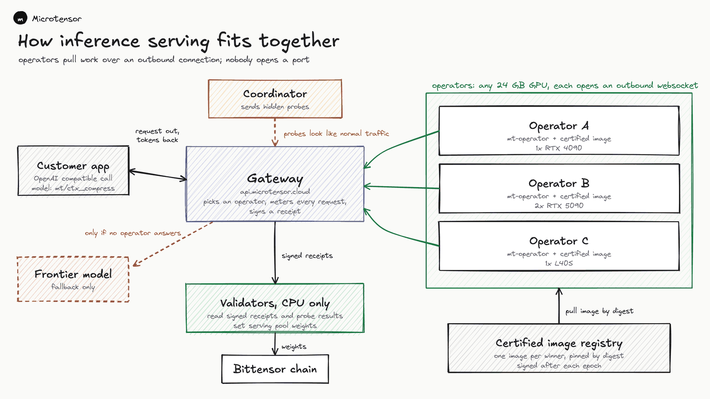
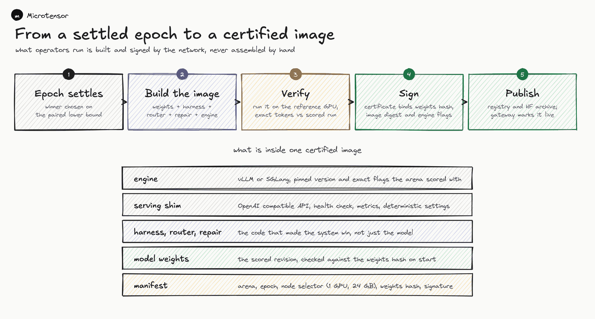
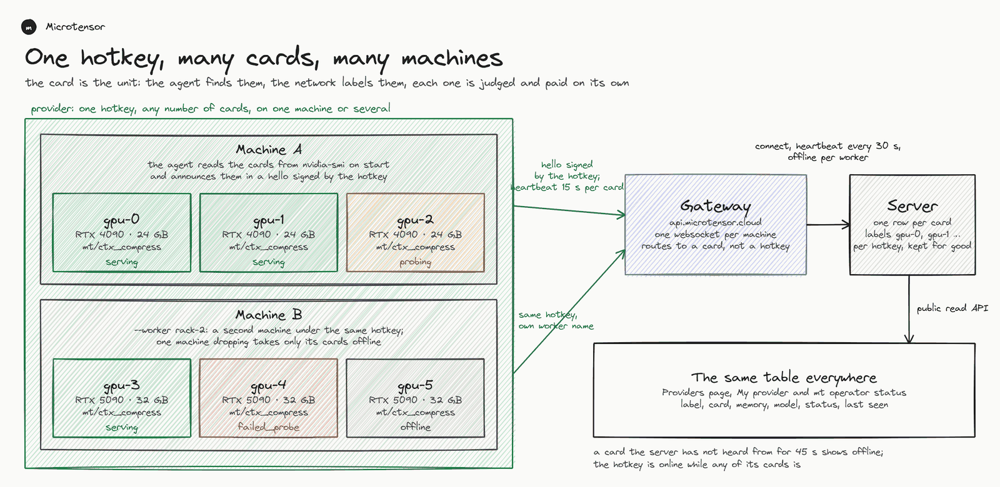
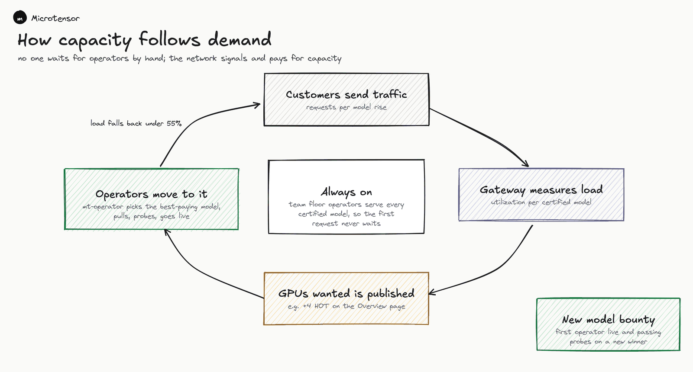
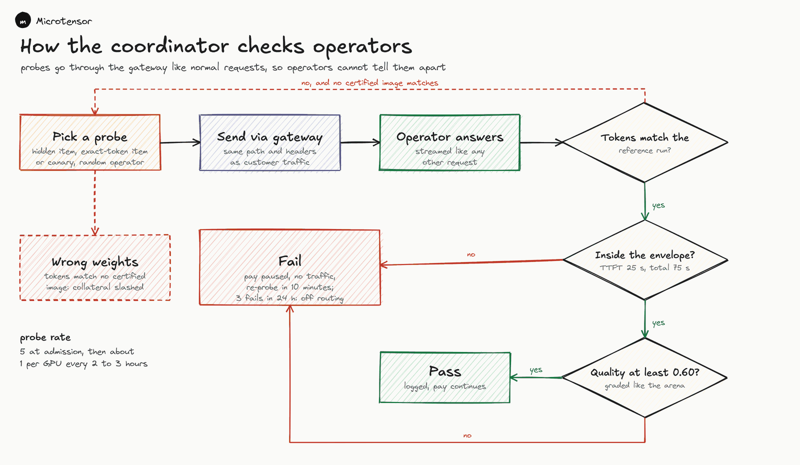
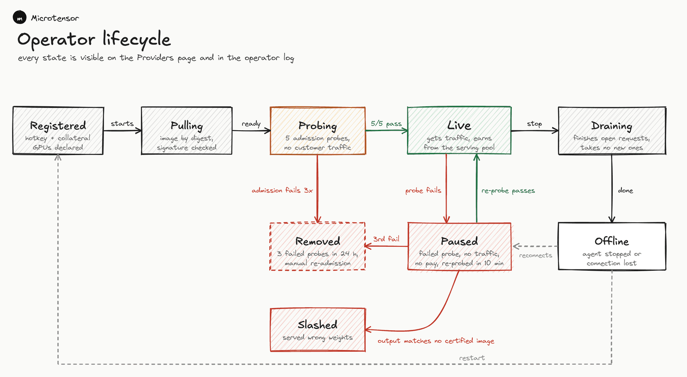
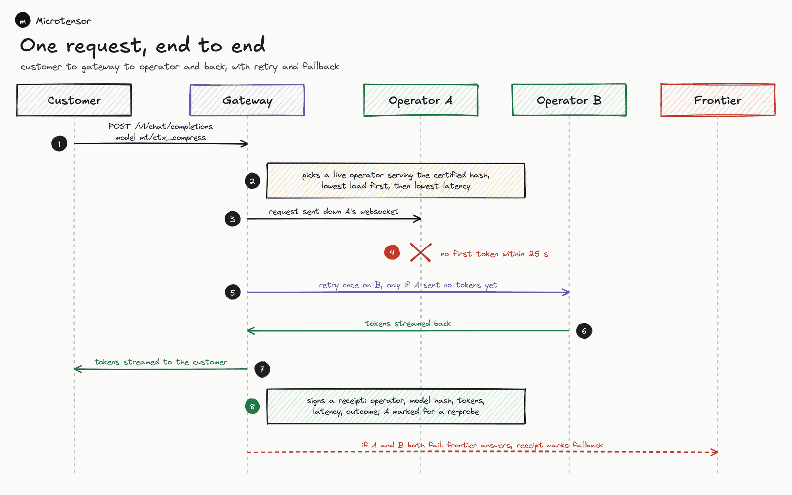

# Serving certified systems

Netuid **576** on Bittensor testnet. An inference operator holds the certified system of one or more arenas on its own GPUs and answers customer requests that the gateway at api.microtensor.cloud routes to it. Serving is a separate role from model mining and validating, with its own hotkey and its own settlement. The network shows every provider and every card at https://www.microtensor.cloud/network/inference.



The gateway keeps the registry of cards, routes every request to one card, meters it and signs a receipt for it. The agent on each machine dials out, so nothing listens on a public port and a rented GPU works. The coordinator and permitted validators probe through the same gateway, and validators set the serving pool weights on CPU from the receipts and the probe verdicts. The frontier model answers only when no card can, and only where the gateway is given an upstream; otherwise such a request is refused and recorded.

## What you run



Each held system is the four part artifact its miner submitted and validators certified: a small model served by vLLM, a router served as a classifier, and the miner's harness and repair code. After an epoch settles the coordinator builds one image per winning submission holding the engine, the weights, the harness, the router and the repair code, replays forty scored calls through it on the reference GPU requiring an exact token match, signs the manifest and publishes the image to the registry and the archive; the catalogue then carries it as `images.certified`. Your host runs that image, one per GPU, and dials out to the gateway over a websocket. Nothing listens on a public port.

## GPUs



The GPU is the unit. One hotkey owns any number of cards, on one machine or several, and each card holds one model. The agent reads the cards from `nvidia-smi` on start, answers the gateway's challenge with a hello signed by the hotkey that announces them, and the network labels them `gpu-0`, `gpu-1` and so on in the order it first sees them. The labels stay with the cards across restarts and appear on the public provider page and in `mt operator status`. The agent connects before anything is loaded, so a card shows `pulling` while its model downloads and `probing` once it is ready; every 10 seconds it reports each card's phase, requests in flight, memory in use and utilisation, and a card the network has not heard from for 45 seconds shows offline.

Several machines under one hotkey each run the agent with their own `--worker` name. One machine dropping takes only its cards offline. Once a card has loaded a model the agent sends `ready` for it and the server answers whether it is `probing` or `serving`; customers reach it only after admission.

The planner spreads the cards over the models the network wants, most wanted first, one model per card and the same model on several cards when demand asks for it. The gateway also sends `assign` suggestions from the GPUs wanted signal, which the planner takes as its first preference when the card can hold the model. A card keeps its model unless something clearly wants serving more. When the agent stops, or before it updates itself, it drains: open requests finish, no new ones arrive, and the gateway hears `drained` before the connection closes.

The sandbox is a locked down Docker container: no network except the gateway to the four service URLs, CPU, memory and process limits, a read only root file system, the artifact and the model mounted read only, every capability dropped and no privilege escalation. No extra container runtime is needed.

## Requirements

| | |
|---|---|
| OS | Ubuntu 22.04 or 24.04 |
| GPU | one or more 24 GB cards (RTX 4090, L4, A10G or better), CUDA 12 driver, one model per card; general models state their own class |
| CPU and RAM | 8 cores and 32 GB per card |
| Disk | NVMe, 100 GB per held model, under `/var/lib/microtensor` |
| Software | Docker 27 or newer, NVIDIA Container Toolkit |
| Network | outbound 443 only; one system downloads once per epoch |
| Stake | none on testnet; mainnet collateral is announced before launch |

Host preparation (Docker, the NVIDIA toolkit, `/var/lib/microtensor`) is the same as for a validator: follow step 1 of [validator_setup.md](validator_setup.md) and confirm the CUDA check passes.

## 1. Register and post collateral

```bash
docker run --rm -it -v ~/.bittensor/wallets:/wallets:ro -e MT_WALLET_PATH=/wallets \
  --entrypoint mt ghcr.io/microtensor-io/validator:1 \
  operator register --label "my node" --wallet.name <coldkey> --wallet.hotkey <hotkey>
```

On testnet that is all: the answer shows `collateral_required_tao: 0` and the hotkey can declare and serve at once. When the answer names an amount, transfer it to the coldkey it names and report the extrinsic:

```bash
docker run --rm -it -v ~/.bittensor/wallets:/wallets:ro -e MT_WALLET_PATH=/wallets \
  --entrypoint mt ghcr.io/microtensor-io/validator:1 \
  operator collateral --reference <extrinsic hash> --block <block> --wallet.name <coldkey> --wallet.hotkey <hotkey>
```

## 2. See what the network wants



```bash
docker run --rm --gpus all --entrypoint mt ghcr.io/microtensor-io/validator:1 operator plan
```

The plan lists the cards it found and reads the public catalogue (`GET /v1/public/inference/catalogue`), then gives each card the model that wants serving most: `wanted` first, then requests in the last hour divided by the cards already holding it, cold models first, held models kept unless something clearly wants serving more. `wanted` is one card when requests arrive and none is online, otherwise the cards needed to bring the model's utilisation above 55% back to 40%. A model whose `vram_gb` exceeds the smallest card is skipped with the reason. `--gpus 0,1` limits the cards; `--gpu-gb` is only read when `nvidia-smi` cannot be asked.

## 3. Run

Write the config file and start the agent with one command:

```yaml
hotkey_path: /wallets/<coldkey>/hotkeys/<hotkey>
gateway: wss://api.microtensor.cloud/v1/operators/socket
gpus: all                    # or a list of GPU indexes
models: auto                 # or a list of certified model names
max_concurrency_per_gpu: 8
cache_dir: /data/cache
collateral_tao_per_gpu: 0
```

```bash
docker run -d --name mt-operator --gpus all --restart unless-stopped \
  -v ~/.bittensor/wallets:/wallets:ro \
  -v /var/lib/mt-operator:/data \
  -v /var/run/docker.sock:/var/run/docker.sock \
  ghcr.io/microtensor-io/mt-operator:latest --config /data/operator.yaml
```

The image is the validator image with `mt operator run` as its entrypoint; flags on the command line override the file. `max_concurrency_per_gpu` is how many requests a card takes at once: the certified image runs that many workers against one engine, so the engine batches them. The compose file keeps working for hosts that prefer it:

```bash
cd microtensor-subnet/deploy
cat > .env <<EOF
MT_WALLET_NAME=<coldkey>
MT_WALLET_HOTKEY=<hotkey>
DOCKER_GID=$(getent group docker | cut -d: -f3)
EOF
docker compose -f docker-compose.operator.yml up -d
docker compose -f docker-compose.operator.yml logs -f
```

Every card `nvidia-smi` lists is used; set `MT_GPUS=0,1` to use some of them. On a second machine under the same hotkey set `MT_WORKER=<a name for that machine>`.

For one pinned system instead of the planner, run `operator run --serve mt/<arena>@<artifact sha prefix>` with the pin from the catalogue.

On start the host dials the gateway, then per card either pulls the model's certified image by digest (`images.certified` in the catalogue) and runs it with the GPU passed through, or, while no image is certified, fetches the system's two repositories at the committed revisions, verifies every manifest hash and starts vLLM for the model, the router server and the sandbox itself. The certified image holds the engine, the weights, the harness, the router and the repair code of the winning submission; on start it checks the weights against the hash in its build record and refuses to serve on a mismatch, then answers on localhost only. Either way the host declares the system to the server (`POST /v1/inference/operators/models`) and sends `ready` for the card. Expect ten to twenty minutes before the first answer on a fresh cache. Every `--review-seconds` (300) the catalogue is read again; the connection is kept unless the plan changed what a card holds.

`mt operator status` prints one line per card the network knows under this hotkey: label, card, memory, model loaded, status and last seen.

## Updates

The agent image is pinned by digest. The network publishes the current image, its digest and the lowest version it still accepts (`GET /v2/agent`). Every review the agent compares the image it runs with the published one; when they differ it pulls the published digest, verifies it, writes it to `.env` as `MT_AGENT_IMAGE` and restarts itself from the compose file through a short lived helper container, which is why the compose file and `.env` are mounted into the container. Pass `--no-auto-update` to stay on the image you chose; a hello from an agent below the minimum version is refused at the gateway with both versions named.

Certified systems run on the engine build their arena was certified with: the catalogue names the engine image and digest per model and the agent refuses any other.

## 4. Admission



Probes reach each card through the gateway on the same path and frames as customer traffic, so a card cannot tell them apart. Three kinds exist: a hidden item from the withheld pool, graded with the arena's grader and passed at a quality of at least 0.60 inside the envelope; an exact token check, the same request replayed on the reference run, whose output tokens must match; and a short canary with a known reply. Admission is five probes in a row, all passing; after that a live card sees about one probe every two to three hours (hidden three times in five, exact and canary once each), plus one after any timeout. The coordinator runs the loop for every card, and validators the network permits add to it. A failed probe pauses the card: no traffic and no pay, probed again after ten minutes, back to serving on a pass. Three failed probes within 24 hours remove the card until the team re-admits it by hand; an exact token mismatch the coordinator confirms on its reference run slashes the operator. The hotkey's other cards carry on throughout. A new epoch winner resets admission for that model, so re-admission after each epoch is normal. The probe log on the provider page shows kind, size and timings, never the item.



| State | Meaning | Customers | Paid |
|---|---|---|---|
| `registered` | the card is announced; nothing is loading yet | no | no |
| `pulling` | the model's image or repositories are downloading, or the engine is starting | no | no |
| `probing` | ready; the five admission probes are not all passed yet | no | no |
| `serving` | admitted; customers and probes | yes | yes |
| `paused` | a probe failed; probed again after ten minutes | no | no |
| `removed` | three failed probes within 24 hours; the team re-admits by hand | no | no |
| `draining` | finishing open requests before a stop or an update; no new ones | no | for finished work |
| `offline` | no heartbeat for 45 seconds, or its machine dropped | no | no |
| `slashed` | the operator served weights that match no certified image; every card | no | no |

## How a request is answered



The gateway picks a serving card that holds the model, lowest in flight first, and sends a `request` frame with an id, the card, the deadline and `{task, floor, max_tokens}` over the websocket. The host refuses a request whose deadline has passed, registers the task's schema as a SQLite database for the sandbox tools, calls the harness (`POST /harness/run`), sends an empty `chunk` the moment the harness makes its first model call, asks the router for the probability that the draft is right, and answers a `done` frame with `{answer, p, floor_met, verified, trace, usage, ttft_ms, total_ms}`. `floor_met` is whether the harness's own check passed and `p` cleared the customer's quality floor. The gateway counts the tokens, times the first token and the end itself, signs a receipt and records one row per request and card; nothing an operator reports is used for pay. No first token within the limit means the gateway cancels and retries once on another card; when no serving card holds the model the request falls back to the frontier relay where one is configured and is otherwise refused and recorded, which raises `wanted`. No frontier call happens on an operator.

The catalogue's `route` says how a model answers. `system` runs the harness as above. `model` is for a winner that took the SLM pool without an eligible system pool score: the card skips the harness and answers from the model with the arena's prompt, stop list and output limit, greedy, exactly as the pool scored it.

## General models

Beside certified systems, an operator can serve general open weight chat models by name (GLM, Qwen, DeepSeek, Kimi and similar releases) over the same socket. Such a model appears in the catalogue with `kind: "general"`, a repository pinned at a revision, a sha256 manifest of every file it needs, its format, engine settings, context, maximum output, tool calling, family, serving class, memory and licence.

| Format | Engine | Image |
|---|---|---|
| awq, fp8, safetensors | SGLang | `--sglang-image` or `MT_SGLANG_IMAGE` |
| gguf | llama.cpp server | `--llama-image` or `MT_LLAMA_IMAGE` |

Serving classes are `gpu_24gb`, `gpu_80gb` and `gpu_8x80gb`. Your class follows the smallest card. The planner keeps one holding per GPU whatever its kind and skips, with the reason, a model whose class or `vram_gb` your card cannot meet or whose engine has no image (pass `none` as an image to turn that engine off).

The host downloads only the files the manifest names (`--hf-token` or `HF_TOKEN` for gated repositories), checks every sha256 and refuses the model on any mismatch, then starts the engine on one GPU with the weights mounted read only and offline. Each answer streams as chunks (content, reasoning, tool call argument fragments) and ends with the full message, usage, and the prompt and completion token ids. The host caps `max_tokens` at the model's maximum output and refuses a prompt that does not fit the context with `context_length_exceeded`.

Every general model records its licence and a link. The host holds none until you pass `--accept-licences` (`MT_ACCEPT_LICENCES=1` in the compose `.env`); without it the planner skips every general model, names its licence and link as the reason, and keeps your GPUs for certified systems. `operator plan` takes the same flag.

```bash
mt operator run --kind model --model glm-4.6-awq --gpus 0 --accept-licences
```

Other flags: `--kind system|model|any` (default any), `--model NAME` and `--family NAME` (repeatable), `--mem-fraction` (share of the card the engine keeps, 0.88).

Not yet live: engine image pins, memory fractions and parser flags are proven per model on a GPU box first, together with verification of general models by canonical prefill and their admission probes. Until that proof the catalogue lists no general model and the planner holds certified systems only.

## How general models are verified

Validators probe each general model through the gateway with a published pool of chat items: a plain question, a JSON reply, one and two step tool calls against a small weather and local time schema, and two long notes that fit 8K and 32K windows. Tool items go only to models that call tools and long items only to models whose context holds them. Probes run at temperature zero.

Every answer is first checked for format. The finish reason must be `stop`, `tool_calls` or `length`; a tool call must name a tool the request offered and carry arguments that parse as a JSON object; an answer that ends for tool calls must carry one. A broken answer is reported as `format`.

A validator that holds the model then verifies the answer by canonical prefill. It renders the prompt with the model's chat template and compares your prompt token ids with it, rebuilds the completion from the returned content, reasoning and tool calls in the family's raw format with its end of turn marker, and runs one forward pass over prompt and completion on its own copy of the pinned weights (SGLang `/generate` with input logprobs, or llama.cpp in process for GGUF). At every generated position it measures how far the returned token sits below the model's top choice. A substituted model, a cheaper quantisation or an edited answer leaves the top choice where the pinned weights would not, and a mean margin above the calibrated threshold is reported as `cheat`. When your prompt ids differ from the validator's template, the completion cannot be rebuilt or the prefill fails, the probe is `unproven`: it is recorded and never moves admission either way. `cheat` and `format` count as failed probes in admission and in the `cheat_share` gate of the serving settlement.

Prefill verification shows that the text you returned is what the pinned weights produce greedily for that prompt. It does not cover sampled answers, latency (measured from metering) or models no validator class can hold. A model whose `verifiable_on` is empty (the largest releases) is probed by outcome and format only: an answer from the listed digest that passes the format checks counts as a pass, and the catalogue says so per model.

Calibration and the per model verifiability table wait for a GPU box. A threshold is measured per model and digest from honest answers and from a substitute model (`mt epoch probe --general MODEL --calibrate --substitute OTHER`, with `--verify-backend sglang|llama`, `--engine-url` and `--gpu`) and stored under the validator's `calibration/<model>/<digest>.json`; a validator without one refuses to probe that model, and a threshold that never separated a substitute leaves every verdict `unproven`. No general model is listed before those numbers exist.

## Earnings

Two sources, both per arena, settled per card.

**Revenue share.** When billing opens you receive 95% of the metered billing for the requests you served; Microtensor keeps 5%. A request that fell back to a frontier model is billed to the customer at the frontier list price and passed through; it is outside the 95%. On testnet every answered request counts as billed for the pool and no customer is charged.

**The serving pool.** Each arena's epoch emission sets aside a serving pool for inference operators, at most 10% at launch, and splits the rest equally across the five system pools (18% each). A serving epoch is one UTC day, closed at midnight, so every validator settles the same window from the same receipts. At epoch close every validator reads the published settlement, checks the receipts root and every gateway signature, recomputes the scores and pays the pool by score per card: a card's score is the requests it served successfully, each weighted 1.0 inside the envelope and 0.5 outside it, times the card's probe pass rate for the window; time spent paused earns nothing. Your share is your score over the sum of paid scores. The rebate keeps the pool at 1/25 of the billing served, and serving emission that no score earned is burned to the burn hotkey, the same rule as an empty system pool; it never flows back to the system pools.

**One hotkey per coldkey.** Only the hotkey with the highest score under a coldkey is paid; the others score zero and their share burns. Operators the team flags as its own earn nothing from the pool.

**New model bounty.** The first outside operator whose card goes live on a newly certified image earns the arena's `bounty_share` of the pool for that window (5% unless the arena sets otherwise); unclaimed bounties burn.

The cap slides with the arena's billing over the last 30 days, read from the gateway each epoch, and the freed share returns to the five system pools:

| Monthly billing | Serving pool |
|---|---|
| below 5,000 USD | 10% |
| below 50,000 USD | 5% |
| above | 2% |

**Admission floor.** Where the arena sets one, a newly admitted operator earns a small fixed share of the serving pool for its first serving epochs even at zero traffic, so a new arena always has someone serving. After that, pay is usage only.

**Receipts.** The gateway signs one receipt per request with its Ed25519 key (`policy.receipt_public_key` in the catalogue): request id, time, hashed customer key, model, image digest, operator, card, tokens, first token and total time, outcome, probe flag and price. The settlement names the Merkle root of the window's receipts and `GET /v1/public/inference/receipts?since=&until=` exports them; `mt operator audit` recomputes the root, checks the signatures and the scores, and a validator burns the pool rather than pay from a settlement whose receipts do not add up. Inputs above the arena's `long_above_tokens` count as inside the envelope under the long input limits (`long_ttft_ms`, `long_e2e_ms`) instead of the ordinary ones.

## Troubleshooting

- `the docker socket is not reachable`: mount `/var/run/docker.sock` and set `DOCKER_GID`.
- `the model server did not become ready`: the card is too small for the model or another process holds it; `nvidia-smi` on the host.
- `this operator does not hold that system`: the gateway routed a model the plan dropped; it recovers at the next review.
- `agent ... is below the ... this network requires`: the published minimum moved; let the updater run, or pull the published digest yourself.
- A card stays `probing`: it is not admitted yet, or its model is not the admitted digest; `mt operator status` shows which.
